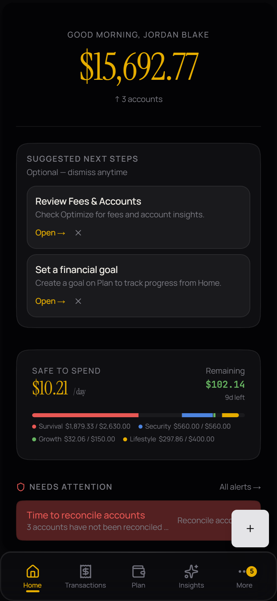
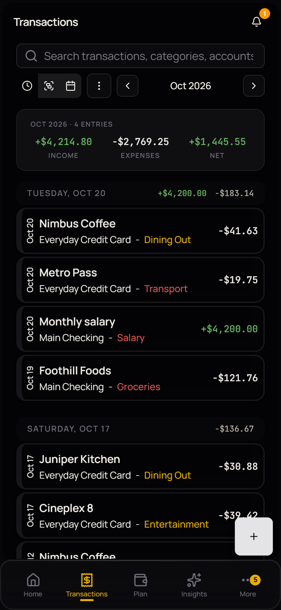
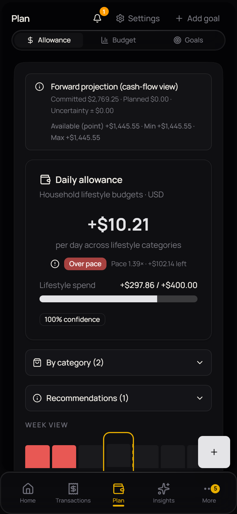
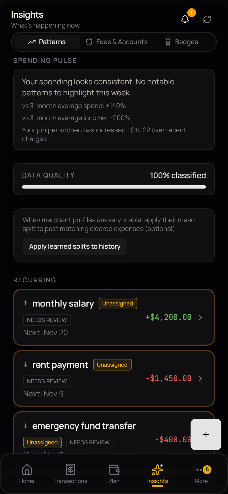
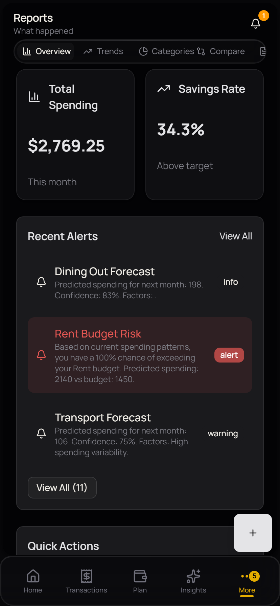

# Budgic

> **Personal finance management** — offline-first, category- and plan-driven.

Budgic is a local-first budgeting app. It tracks accounts and transactions, runs a **unified budget with waterfall tiers**, and turns the result into a single **Safe to Spend** number plus spending insights.

Your data lives in **IndexedDB on your device**. No sign-up, no cloud sync, no telemetry. Network access is optional and only used for exchange rates.


[](https://github.com/ces-cimes/budgic/actions/workflows/test.yml)
[](./LICENSE)

## Screenshots

| Home — Safe to Spend                   | Transactions                                           | Plan                                   |
| -------------------------------------- | ------------------------------------------------------ | -------------------------------------- |
|  |  |  |

| Insights                                       | Reports                                      |
| ---------------------------------------------- | -------------------------------------------- |
|  |  |

## What it does

- **Accounts** — multiple account types (checking, savings, credit, crypto), balances, and per-account pace.
- **Transactions** — income, expense, transfer, and adjustments, with soft and hard split support and reconciliation.
- **Plan** — one area holding **Allowance**, **Budget**, and **Goals**. Budget categories are ordered by waterfall tier: _survival → security → growth → lifestyle_.
- **Insights** — spending patterns, fee risk, credit utilisation, recurring-transaction detection, and behavioural analysis.
- **Reports** — period-aligned metrics and category breakdowns.
- **Import / export** — CSV import through an extensible importer interface (Money Manager is one source), plus JSON backup and restore.
- **Settings** — profile, display, currency, plan preferences, and a full data reset.

## How it's built

**Offline-first.** Every read and write goes to IndexedDB through Dexie; services are plain classes behind a singleton, and the UI is a thin layer over them. The app works with no network at all, and the server is only ever a convenience — exchange rates, optional backup.

**Waterfall budgeting.** Rather than treating categories as a flat list of envelopes, Budgic assigns each category to one of four tiers and funds them in priority order. The daily allowance and the "Safe to Spend" figure both fall out of that ordering, which is why the allowance math is the most heavily tested part of the codebase.

**A documented design system.** Typography, colour, motion, and overlay primitives come from the Design Bible and are implemented as Tailwind tokens.

**Typed end to end.** Zod schemas validate at the database boundary, and `svelte-check` runs clean under strict TypeScript. A pre-commit hook warns when a new `any` type appears.

## Tech stack

| Layer        | Choice                                                                                                  |
| ------------ | ------------------------------------------------------------------------------------------------------- |
| Framework    | [SvelteKit 2](https://kit.svelte.dev/) + [Svelte 5](https://svelte.dev/) (runes)                        |
| Language     | TypeScript (strict)                                                                                     |
| Storage      | [Dexie.js](https://dexie.org/) over IndexedDB, validated with [Zod](https://zod.dev/)                   |
| Styling      | [Tailwind CSS 4](https://tailwindcss.com/), shadcn-svelte / [bits-ui](https://bits-ui.com/), Lucide     |
| Charts       | [LayerChart](https://layerchart.com/)                                                                   |
| i18n         | [Paraglide JS](https://inlang.com/m/gerwe/sdk) (messages scaffolded, translation pass deferred)         |
| Native shell | [Capacitor](https://capacitorjs.com/) (Android); [Tauri](https://tauri.app/) is a possible future shell |
| Testing      | [Vitest](https://vitest.dev/) + Testing Library                                                         |
| Tooling      | ESLint, Prettier, Husky, GitHub Actions                                                                 |

## Getting started

Requirements: **Node.js 18+** and npm.

```bash
git clone https://github.com/ces-cimes/budgic.git
cd budgic
npm install
npm run dev
```

The dev server prints its URL (Vite default: <http://localhost:5173>). The app starts empty — create an account from the Home screen to get going.

### Build

```bash
npm run build          # production build (PWA target)
npm run build:native   # production build for the Capacitor shell
npm run preview        # smoke the production build locally
```

The production build is consumed by the native project (Capacitor), not deployed as a public website.

## Testing and quality gates

```bash
npm test               # Vitest — 441 tests across 67 files
npm run check          # svelte-check (0 errors expected)
npm run lint           # Prettier check + ESLint
npm run validate       # lint + check together
```

CI runs `check`, `lint`, `test`, and coverage on every push and pull request. Husky enforces Prettier/ESLint on staged files and conventional-commit messages at commit time.

## Project structure

```
budgic/
├── src/
│   ├── lib/
│   │   ├── core/           # db.ts (Dexie + Zod schemas) and services/
│   │   ├── components/     # UI and feature components
│   │   ├── backup/         # Backup payload format and restore helpers
│   │   └── utils/          # Shared helpers (currency, dates, splits)
│   └── routes/             # SvelteKit routes (+page, +layout, +server)
├── android/                # Capacitor Android project
├── docs/informational/     # Design system, UX spec, service architecture
└── static/                 # Icons and screenshots
```

Services follow a singleton pattern (`class XService {}` → `export const xService = new XService()`) and are grouped by concern under `src/lib/core/services/`: `core/` for domain logic, `analytics/` for insight generation, `import-export/`, and `person-ledger/`.

## Documentation

| Doc                                                                                               | What's in it                                             |
| ------------------------------------------------------------------------------------------------- | -------------------------------------------------------- |
| [Service architecture](./docs/informational/architecture/SERVICE_ARCHITECTURE.md)                 | Service categories, patterns, and responsibilities       |
| [Strategic system map](./docs/informational/architecture/STRATEGIC_SYSTEM_MAP.md)                 | Routes → services → Dexie, and the doc-drift table       |
| [Service interaction diagrams](./docs/informational/architecture/SERVICE_INTERACTION_DIAGRAMS.md) | Mermaid dependency graphs                                |
| [Design Bible](./docs/informational/DESIGN_BIBLE.md)                                              | Visual language — typography, colour, motion, components |
| [UX spec](./docs/informational/UX_SPEC.md)                                                        | Information architecture, routes, screens, flows         |
| [Overlay patterns](./docs/informational/overlay-patterns.md)                                      | Choosing between Dialog / Drawer / Panel primitives      |
| [Dirty-data strategy](./docs/informational/dirty-data-strategy.md)                                | Import-vs-infer philosophy for imperfect data            |
| [Data quality UX](./docs/informational/data-quality-ux.md)                                        | How uncertainty is surfaced in the interface             |
| [Changelog](./CHANGELOG.md)                                                                       | Completed work, newest first                             |

## Status

Actively developed and used as a daily driver. The core loop — accounts, transactions, plan, insights — works end to end and is covered by tests. Known rough edges: some route components and `db.ts` are larger than they should be, a handful of analytics surfaces are still iterating, and the full i18n translation pass is deferred.

## License

MIT — see [LICENSE](./LICENSE).
