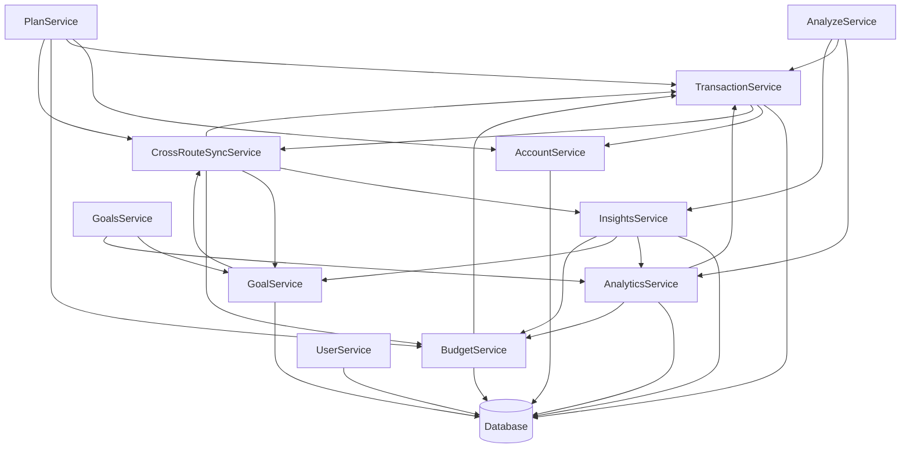

# Budgic Service Architecture Documentation

## Overview

Services are grouped into categories, and each category follows the same shape: a class with a singleton export, Zod validation at the boundary, Dexie for persistence.

## Architecture Principles

- **Service-oriented.** Each service owns one domain's business logic. Services are stateless and reusable.
- **Categorized.** Services sit in logical categories, with a dependency hierarchy between the categories.
- **Consistent.** The same interface patterns, error handling, and JSDoc on every service.
- **Type-safe.** TypeScript throughout, Zod schemas for all data, no `any` types.

## Service Categories

### **Core Services** (`src/lib/core/services/core/`)

Core services own the fundamental business logic:

#### **AccountService**

- **Purpose**: Account management and balance calculations
- **Key Methods**:
    - `createAccount()` - Create new accounts with validation
    - `getAccounts()` - Retrieve all active accounts
    - `getAccountBalance()` - Get current account balance
    - `recalculateAccountBalance()` - Recalculate balance from transactions
- **Dependencies**: Database (Dexie), TransactionService
- **Data**: Account entities, balance calculations

#### **TransactionService**

- **Purpose**: Transaction CRUD operations and business rules
- **Key Methods**:
    - `createTransaction()` - Create transactions with validation
    - `getAllTransactions()` - Retrieve all transactions
    - `updateTransaction()` - Update existing transactions
    - `createTransactionGroup()` - Handle split transactions
- **Dependencies**: Database (Dexie), AccountService, CrossRouteSyncService
- **Data**: Transaction entities, transaction groups

#### **BudgetService**

- **Purpose**: Budget allocation and waterfall budgeting
- **Key Methods**:
    - `getBudgetSummary()` - Get comprehensive budget data
    - `allocateBudget()` - Perform waterfall budget allocation
    - `getCategoryBudget()` - Get budget for specific categories
- **Dependencies**: Database (Dexie), TransactionService
- **Data**: Budget categories, allocation rules

#### **GoalService**

- **Purpose**: Goal tracking and progress monitoring
- **Key Methods**:
    - `createGoal()` - Create new financial goals
    - `getAllGoals()` - Retrieve all goals
    - `updateGoal()` - Update goal progress
    - `calculateGoalProgress()` - Calculate progress metrics
- **Dependencies**: Database (Dexie), CrossRouteSyncService
- **Data**: Goal entities, progress calculations

#### **UserService**

- **Purpose**: User preferences and behavior tracking
- **Key Methods**:
    - `getUserPreferences()` - Get user settings
    - `updateUserPreferences()` - Update user settings
    - `trackUserAction()` - Track user behavior
- **Dependencies**: Database (Dexie)
- **Data**: User preferences, behavior analytics

### **Analytics Services** (`src/lib/core/services/analytics/`)

Analytics services handle data analysis, insights, and cross-route sync:

#### **AnalyticsService**

- **Purpose**: Financial analytics and trend analysis
- **Key Methods**:
    - `getSpendingAnalysis()` - Analyze spending patterns
    - `getFinancialHealthScore()` - Calculate health metrics
    - `getTrendAnalysis()` - Analyze financial trends
- **Dependencies**: Database (Dexie), TransactionService, BudgetService
- **Data**: Analytics data, trend calculations

#### **InsightsService**

- **Purpose**: Insight generation and management
- **Key Methods**:
    - `generateCrossRouteInsights()` - Generate insights from multiple data sources
    - `getInsights()` - Retrieve all insights
    - `createInsight()` - Create new insights
    - `dismissInsight()` - Mark insights as dismissed
- **Dependencies**: Database (Dexie), AnalyticsService, GoalService, BudgetService
- **Data**: Insight entities, cross-route data

#### **CrossRouteSyncService**

- **Purpose**: Real-time synchronization across application routes
- **Key Methods**:
    - `emitSyncEvent()` - Emit synchronization events
    - `processSyncEvent()` - Process incoming sync events
    - `start()` / `stop()` - Control sync service lifecycle
- **Dependencies**: All core services, InsightsService
- **Data**: Sync events, cross-route state

### **Page Services** (`src/lib/core/services/pages/`)

Page services handle page-specific logic and data aggregation:

#### **AnalyzeService**

- **Purpose**: Analyze page data processing and visualization
- **Key Methods**:
    - `loadAnalytics()` - Load analytics data for visualization
    - `loadInsights()` - Load insights for display
    - `generateCategoryData()` - Generate category breakdowns
- **Dependencies**: AnalyticsService, TransactionService, InsightsService
- **Data**: Visualization data, category breakdowns

#### **GoalsService**

- **Purpose**: Goals page data management
- **Key Methods**:
    - `getGoalsData()` - Get comprehensive goals data
    - `getGoalInsights()` - Generate goal-specific insights
    - `getGoalAnalytics()` - Calculate goal analytics
- **Dependencies**: GoalService, AnalyticsService
- **Data**: Goals data, progress analytics

#### **PlanService**

- **Purpose**: Planning page projections and insights
- **Key Methods**:
    - `getPlanningData()` - Get planning data for account
    - `getWeeklyProjections()` - Generate weekly projections
    - `getDailyAllowance()` - Calculate daily spending allowance
- **Dependencies**: AccountService, TransactionService, BudgetService, CrossRouteSyncService
- **Data**: Planning projections, allowance calculations

## Service Dependencies



## Service Patterns

### 1. **Service Class Structure**

````typescript
/**
 * ServiceName
 *
 * Brief description of the service purpose and responsibilities.
 *
 * @example
 * ```typescript
 * import { serviceName } from '$lib/core/services';
 *
 * const data = await serviceName.getData();
 * ```
 */
class ServiceName {
	// Public interface
	public get ready() {
		return db.isOpen();
	}

	public isLoading() {
		return !this.ready;
	}

	async load() {
		// Service initialization logic
	}

	// Service-specific methods with comprehensive JSDoc
	async methodName(params: Type): Promise<ReturnType> {
		// Implementation
	}
}

/**
 * Singleton instance of ServiceName
 */
export const serviceName = new ServiceName();
````

### 2. **Error Handling Pattern**

```typescript
async methodName(data: unknown): Promise<Result> {
    try {
        // Validation
        const validatedData = Schema.parse(data);

        // Business logic
        const result = await performOperation(validatedData);

        return result;
    } catch (error) {
        if (error instanceof z.ZodError) {
            throw new ValidationError('Invalid data', error.errors[0].path.join('.'));
        }
        console.error('Service error:', error);
        throw new ServiceError('Operation failed', 'ServiceName', 'methodName');
    }
}
```

### 3. **Database Integration Pattern**

```typescript
import { db, generateUUID } from '$lib/core/db';

async createEntity(data: CreateEntityData): Promise<Entity> {
    const entity: Entity = {
        id: generateUUID(),
        ...data,
        createdAt: new Date().toISOString(),
        updatedAt: new Date().toISOString()
    };

    await db.entities.add(entity);
    return entity;
}
```

## Data Flow

### 1. **Create Operations**

1. Validate input data with Zod schemas
2. Generate unique ID and timestamps
3. Store in database
4. Emit sync events (if applicable)
5. Return created entity

### 2. **Read Operations**

1. Query database with appropriate filters
2. Transform data if needed
3. Return results

### 3. **Update Operations**

1. Validate input data
2. Retrieve existing entity
3. Merge updates with existing data
4. Update timestamps
5. Store in database
6. Emit sync events (if applicable)
7. Return updated entity

### 4. **Delete Operations**

1. Perform soft delete (mark as deleted)
2. Update timestamps
3. Emit sync events (if applicable)

## Cross-Route Synchronization

The `CrossRouteSyncService` enables real-time updates across different parts of the application:

### **Event Types**

- `goal_created` / `goal_updated` / `goal_deleted` / `goal_completed`
- `transaction_created` / `transaction_updated` / `transaction_deleted`
- `budget_updated` / `category_updated`

### **Event Flow**

1. Service performs operation (create/update/delete)
2. Service emits sync event via `CrossRouteSyncService`
3. Sync service processes event and updates related data
4. Insights are generated based on changes
5. UI components receive updates through reactive state

## Performance Considerations

### 1. **Lazy Loading**

- Services load data on-demand
- No unnecessary data fetching
- Efficient database queries

### 2. **Caching Strategy**

- In-memory caching for frequently accessed data
- Cache invalidation on data changes
- Optimized for read-heavy operations

### 3. **Database Optimization**

- Proper indexing on frequently queried fields
- Batch operations where possible
- Soft deletes to preserve data integrity

## Testing Strategy

### 1. **Unit Tests**

- Test each service method independently
- Mock dependencies for isolated testing
- Test error handling and edge cases

### 2. **Integration Tests**

- Test service interactions
- Test database operations
- Test cross-route synchronization

### 3. **Service Mocking**

- Create mock services for testing
- Implement service interfaces for testability
- Use dependency injection patterns

## Future Enhancements

### 1. **Service Configuration**

- Environment-specific service settings
- Feature flags for service functionality
- Service-level configuration management

### 2. **Performance Monitoring**

- Service-level performance metrics
- Database query optimization
- Memory usage monitoring

### 3. **Service Discovery**

- Dynamic service registration
- Service health checks
- Automatic failover mechanisms

## Best Practices

### 1. **Service Design**

- Keep services focused on single responsibility
- Use dependency injection for testability
- Implement proper error handling

### 2. **Data Management**

- Always validate input data
- Use soft deletes for data preservation
- Implement proper transaction handling

### 3. **Documentation**

- Comprehensive JSDoc for all methods
- Clear examples in documentation
- Keep architecture docs up to date

### 4. **Error Handling**

- Use specific error types
- Provide meaningful error messages
- Log errors appropriately
