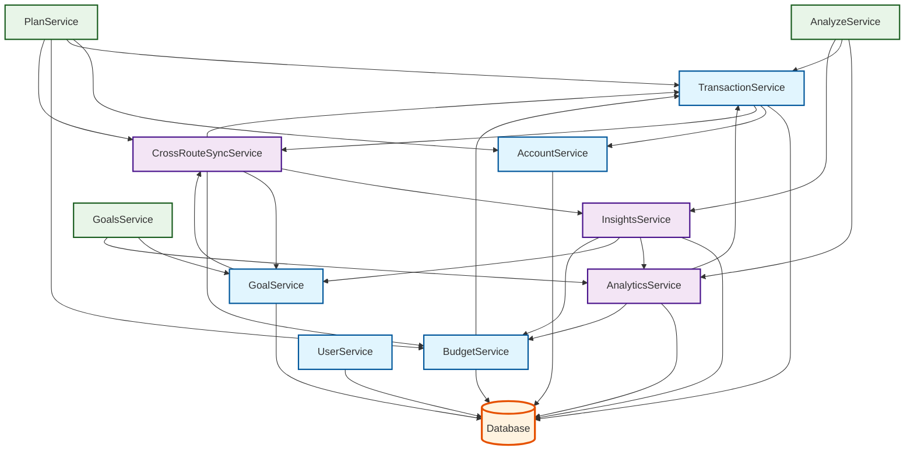
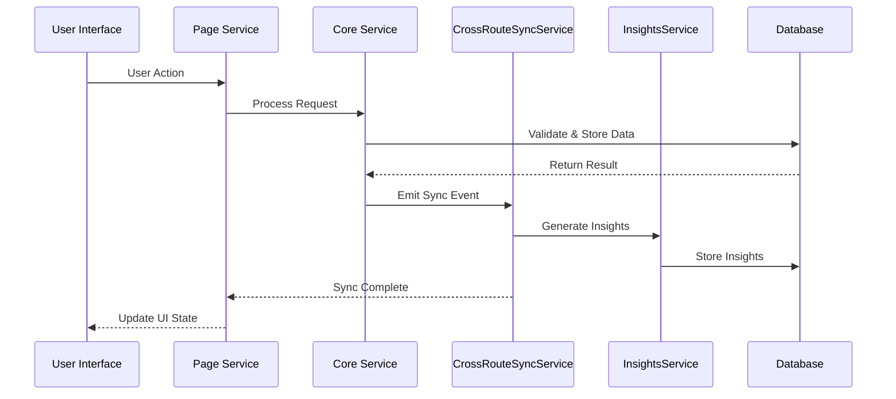
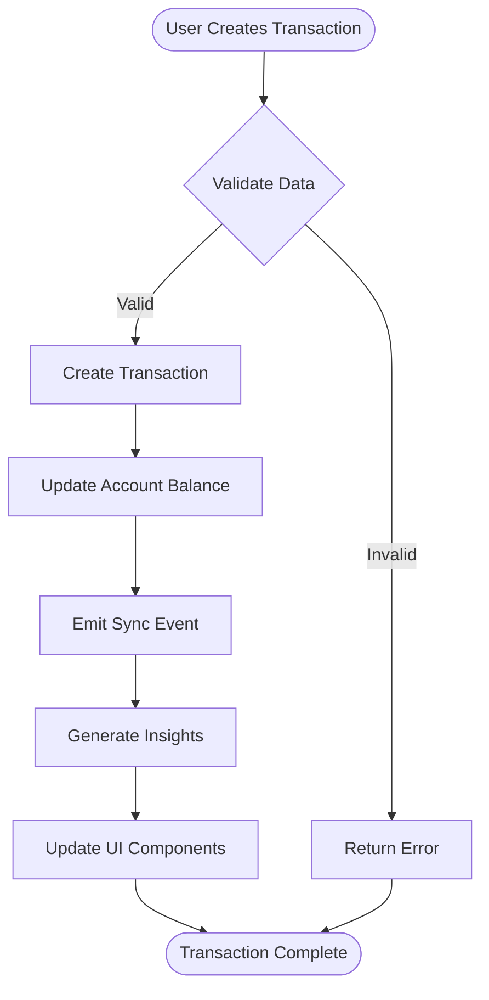
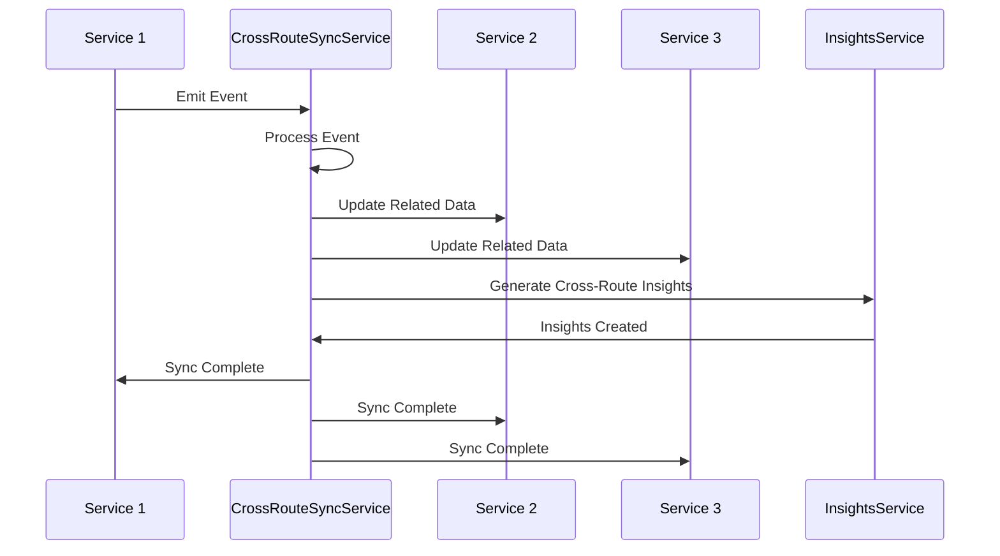
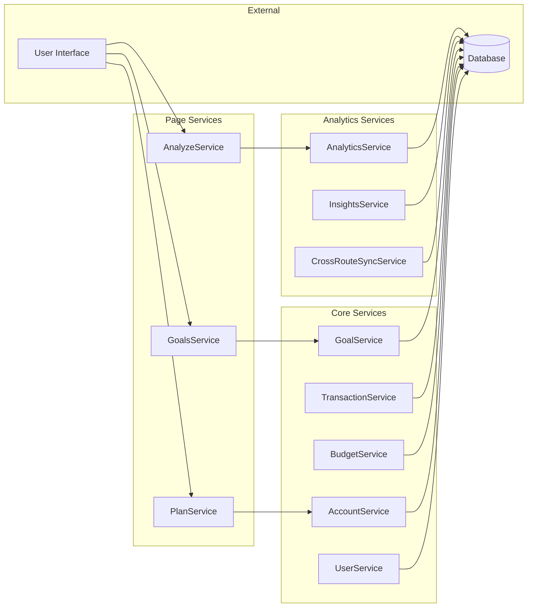
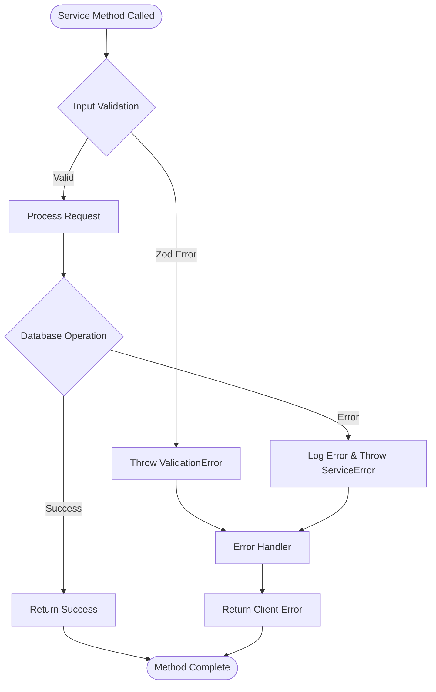
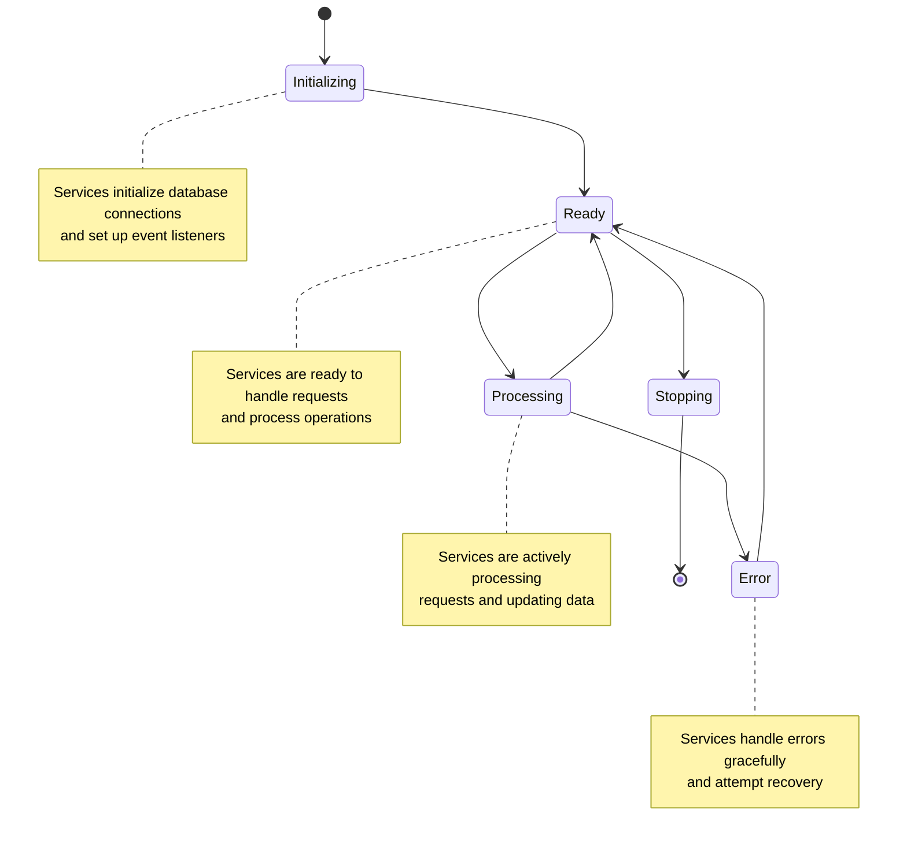

# Service Interaction Diagrams

## Overview
This document contains Mermaid diagrams showing the interactions between different services in the Budgic application.

## Service Dependency Graph

## Data Flow Diagram

## Transaction Processing Flow

## Cross-Route Synchronization Flow

## Service Categories Overview

## Error Handling Flow

## Service Lifecycle

---

*These diagrams are automatically generated and should be updated when service architecture changes are made.*
