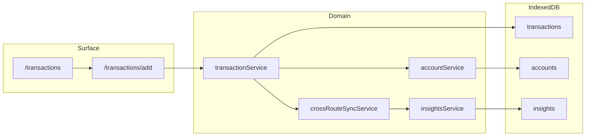

# Strategic system map (product-oriented)

Concise map of how Budgic is wired for **roadmap and scope decisions**. For full service API detail, see [SERVICE_ARCHITECTURE.md](./SERVICE_ARCHITECTURE.md) and [SERVICE_INTERACTION_DIAGRAMS.md](./SERVICE_INTERACTION_DIAGRAMS.md). For UX and navigation truth, see [UX_SPEC.md](../UX_SPEC.md).

---

> **V1 scope decisions (Jul 2026):** Recovery mode **detached** (classifier disabled, manual toggle replaces auto-detection). Fees & Accounts **display-only** (optimization/recommendation logic stripped). Import restructured as extensible path. Full record: [`../../drafts/budgic-v1-scope-decisions.md`](../../drafts/budgic-v1-scope-decisions.md).

---

## Doc drift (architecture docs vs code)

| Topic          | Docs say                            | Code / repo today                                                                                                                                                                                                                                                                                                                                                                                                                                                                                                                                                                                                     |
| -------------- | ----------------------------------- | --------------------------------------------------------------------------------------------------------------------------------------------------------------------------------------------------------------------------------------------------------------------------------------------------------------------------------------------------------------------------------------------------------------------------------------------------------------------------------------------------------------------------------------------------------------------------------------------------------------------- |
| Service layout | Core, analytics, page services only | Also **`import-export/`**, **`intelligence/`**, root **`alerts-aggregation-service`**, **`autocomplete-service`**, **`notifications-service`** (re-exported from analytics barrel)                                                                                                                                                                                                                                                                                                                                                                                                                                    |
| Plan entry     | `PlanService`                       | Singleton is **`planningService`** exported as **`planService`** from [`planning-service.ts`](../../../src/lib/core/services/pages/planning-service.ts)                                                                                                                                                                                                                                                                                                                                                                                                                                                               |
| Routes         | UX spec route tree (March 2026)     | Extra top-level: **`/onboarding`**, **`/data`** (primary data hub), **`/calculator`**, **`/api/exchange-rates`**. **`/settings/data`** redirects to **`/data`**. Legacy compat redirects (remove in Milestone E): **`settings/occasions`**, **`settings/sidebar`**, **`settings/security`**. **`/accounts/reconciliation`** exists but reconcile UX lives on **`/data?tab=reconcile`**. Reconciliation attention: **Data badge = open issues only**; stale check-up → **`reconciliation_due`** insight (bell). Plan deep links in UX §2.1 (`/plan/goals/add`, etc.) are **`/plan` tabs/sheets**, not separate routes. |

Prefer **this file + `db.ts` + exports in `services/*/index.ts`** when docs and behavior disagree.

---

## Capability matrix (surface → domain → persistence)

Rows are product areas. One representative path each—not every import.

| Capability                      | Routes (primary)                                                                     | Domain entrypoints                                                                                                                                                           | IndexedDB stores (v29)                                                                                                 |
| ------------------------------- | ------------------------------------------------------------------------------------ | ---------------------------------------------------------------------------------------------------------------------------------------------------------------------------- | ---------------------------------------------------------------------------------------------------------------------- |
| Home / dashboard                | `/`, [`+page.svelte`](../../../src/routes/+page.svelte)                              | Aggregates via multiple services; sync via `crossRouteSyncService`                                                                                                           | `accounts`, `transactions`, `insights`, …                                                                              |
| Transactions                    | `/transactions`, `/transactions/add/[...id]`                                         | `transactionService`, `dependencyTrackingService`, `dataCorrectionService`                                                                                                   | `transactions`, `tags`, `autocompleteUsage`, `dataCorrections`                                                         |
| Plan (allowance, budget, goals) | `/plan`, `/settings/plan`                                                            | `planService` ← `planning-service`, `budgetService`, `goalService`, allowance via [`allowance-calculation.ts`](../../../src/lib/core/services/core/allowance-calculation.ts) | `categories`, `transactions`, `goals`, `negativeAllowanceEvents`, `envelopeBorrowings`, `rolloverAdjustments`          |
| Insights / intelligence         | `/insights`                                                                          | `insightsService`, `analyticsService`, `optimizationService`, `recurringTransactionIntelligenceService`, …                                                                   | `insights`, `learningPatterns`, `userFeedback`, `optimizationPreferences`, `badges`                                    |
| Reports                         | `/reports`                                                                           | Mostly reads `transactionService` / `analyticsService` patterns                                                                                                              | `transactions`, `categories`                                                                                           |
| Accounts                        | `/accounts`, `/accounts/[id]`, `/accounts/add` (+ legacy `/accounts/reconciliation`) | `accountService`, `passiveAccountService`, `reconciliationService`                                                                                                           | `accounts`, `reconciliationRecords`, `reconciliationDiscrepancies`                                                     |
| Settings                        | `/settings/*`                                                                        | `userService`, `currencyConfigService`, `exchangeRateService`, `roundUpService`, `notificationsService`                                                                      | `userPreferences`, `currencies`, `currencyConfigurations`, `exchangeRates`, `roundUpRules`, `merchantCategoryProfiles` |
| Onboarding / maturity           | `/onboarding`                                                                        | `userService` (preferences), UI gating per [UX_SPEC](../UX_SPEC.md) §1.3                                                                                                     | `userPreferences`, `userActions`                                                                                       |
| Import / export                 | `/data` (primary; `settings/data` redirects)                                         | `MoneyManagerImporter`, `parseCSV`, `inspectSchema`, intelligence helpers (`import-pattern-hints`, merge utilities)                                                          | Same as transactions + accounts + categories on write                                                                  |
| Utilities                       | `/calculator`                                                                        | Mostly UI                                                                                                                                                                    | —                                                                                                                      |
| FX (online)                     | `/api/exchange-rates/[base]`                                                         | Server route + `exchangeRateService` client                                                                                                                                  | `exchangeRates`                                                                                                        |

---

## Product areas and functionality

What each area is **for** in product terms (aligned with [UX_SPEC](../UX_SPEC.md) temporal zones: Past / Present / Future). Implementation may lag the spec in places; use the matrix above for code entrypoints.

### Home (`/`) — Present zone

> **May 2026:** Present zone = **Home only** (not Insights). Allowance **three-tier model**: sidebar widget (desktop T1) · Home `AllowanceSummary` (T2 glance) · Plan Allowance tab (T3). Add **spending pace** widget (week health; shared locale week pref). Home **Needs attention** = Critical + High per [`product-coherence-2026-05.md`](../../analysis/product-coherence-2026-05.md).

- **Daily anchor** (“How am I doing right now?”): quick glance vs short session vs post-log confirmation.
- **Hero:** time-aware greeting, **total balance** (tap → accounts), **allowance T2** (simplified glance; tier bar per UX §3.1.1).
- **Spending pace:** week spent vs planned (same week definition as Plan strip).
- **Needs attention:** Critical + High alerts (cap ~3); honest in-app or external next step.
- **This week:** one bar (spent vs planned), plain-language status (“on track” / “running hot”).
- **Recent transactions:** date groups, limited rows, tap → edit; link to full ledger.
- **Goals snapshot:** conditional; at-risk first; tap → Plan → Goals.
- **First-run checklist:** conditional until account + transaction/import + budget amount on a category are done.

### Alerts (global — bell / “Needs attention”) — Present zone

Cross-cutting; not a dedicated route. See UX section 7.

- **Three tiers:** **Critical** and **High** surface in the **bell panel**; Critical also qualifies for Home **Needs attention**. **Low** tier is contextual only (never in the bell)—reduces noise.
- **Badge** counts unread Critical + High only; colour state (amber vs red) reflects severity mix.
- **Read state:** viewport dwell (~1s) marks read (IntersectionObserver pattern per spec).
- **Implementation tie-in:** fee + negative allowance insight refresh via [`alerts-aggregation-service`](../../../src/lib/core/services/alerts-aggregation-service.ts); full native push backlog lives in actionable docs.

### Transactions (`/transactions`, `/transactions/add/[...id]`) — Past zone

- **Full ledger:** month navigation (swipeable), grouped by day, pagination (“load earlier” by month, not infinite scroll).
- **Summary bar** reflects active filters (period, totals, count).
- **Search** (inline expand) and **filter sheet:** date presets/custom, type (expenses/income), multi-select category and account, amount range, reset-all.
- **Transaction form** (full-screen mobile / modal desktop): progressive disclosure—minimal fields first, **More options** for notes, recurring, groups, reference, advanced optimization fields; **type-aware** layouts (expense vs income vs transfer vs planned vs adjustment) per UX section 4.
- **Edit mode:** dependencies UI when the row has links to other transactions; delete warns on dependents.
- **FAB** from any page: type picker (expense/income/planned variants, transfer) then form (UX section 2.4).

### Plan (`/plan`, settings cog → `/settings/plan`) — Future zone

Single route, **three in-page tabs** (UX section 3.2):

| Tab           | User question                  | Main functionality                                                                                                                                                                                                                                                                                            |
| ------------- | ------------------------------ | ------------------------------------------------------------------------------------------------------------------------------------------------------------------------------------------------------------------------------------------------------------------------------------------------------------- |
| **Allowance** | “Can I spend today?”           | Today card (remaining + tier breakdown), **week strip** (Mon–Sun: actual to date + projected from planned/recurring), **recovery** block when overspent, **30-day cash-flow chart** with buffer bands and payday / large planned markers. No historical date picker on this tab (history belongs in Reports). |
| **Budget**    | “How is the month configured?” | Monthly summary (planned income/expense, net), categories **grouped by waterfall tier** (Survival → Lifestyle), collapsible sections, per-row spent/budget/progress, **category edit sheet**, add-category flow (spec references `/plan/budget/categories/add` as sheet).                                     |
| **Goals**     | “Am I hitting targets?”        | Sub-tabs Overview / Active / Completed; cards with progress, contribution, dates, at-risk fixes inline; new goal CTA (spec: `/plan/goals/add`).                                                                                                                                                               |

Code also wires **debt acknowledgment**, **reimbursements**, **plan rules summary**, **recurring intelligence** for labels/projections—see [`plan/+page.svelte`](../../../src/routes/plan/+page.svelte) imports.

### Insights (`/insights`) — Present / advisory

Three tabs (UX section 3.4); **alerts** stay on the bell, not as a tab here.

| Tab                                                                     | Functionality                                                                                                                                                                                                                                                                                    |
| ----------------------------------------------------------------------- | ------------------------------------------------------------------------------------------------------------------------------------------------------------------------------------------------------------------------------------------------------------------------------------------------ |
| **Patterns**                                                            | Spending pulse (rotating headline insight), **recurring** detection display (“~” for inferred), **anomalies** when present, compact **stat cards** (peak day, biggest category, etc.), **upcoming** one-liner from predictions. New-user placeholder when there is fewer than two weeks of data. |
| **Fees & Accounts** (product name; code tab id may still be `optimize`) | Utilitarian accounting lane: **fee risks**, **credit utilisation**, **interest** opportunities, account-specific mechanics. **Optimization simulator** = explicit what-if only. **No guidance-level gating** (May 2026 product decision).                                                        |
| **Badges**                                                              | Latest earned, “almost there” progress, earned gallery; locked badges not shown until earned.                                                                                                                                                                                                    |

### Reports (`/reports`) — Past zone, reflective

- **Global period** shared with **Transactions month** (changing one updates the other—UX section 3.5).
- **Overview:** headline metrics, savings rate vs last month, **tier donut** (not category-level), generated highlights, top 5 transactions.
- **Trends:** multi-month bars + income overlay, range 3M/6M/1Y/All, savings-rate mini-chart, category sparklines + direction labels.
- **Categories:** sort by spend / budget variance / name; expandable rows with 6-month inline history + period tx list + deep-link to Transactions with category filter.
- **Compare:** two periods, side-by-side table + narrative delta + category deltas (colour semantics tied to budget proximity).
- **Saved:** space for auto monthly summaries (phase); manual export UI (PDF/CSV toggles) per spec.

### Accounts (`/accounts`, `/accounts/[id]`, add flow, reconciliation)

- **List and balances**; navigation to **account detail**.
- **Add/edit account** flow (`/accounts/add/[...id]`).
- **Reconciliation** via **`/data?tab=reconcile`** (legacy `/accounts/reconciliation` may still exist)—`reconciliationService`, `reconciliationRecords` / `reconciliationDiscrepancies`. **May 2026:** auto-bootstrap on create/import; skip (`reconciliationType: skipped`); **nav badge** counts open issues only; **`reconciliation_due`** bell insight for cadence check-up (`userPreferences.reconciliationCheckupIntervalDays`, default 30, Settings → Accounts).

### Settings (`/settings` and children)

Hub for preferences that shape the rest of the app. **Represented routes** (see [`src/routes/settings/`](../../../src/routes/settings/)):

| Path                      | Typical functionality                                                                                                                                                                                                                                     |
| ------------------------- | --------------------------------------------------------------------------------------------------------------------------------------------------------------------------------------------------------------------------------------------------------- |
| `/settings/profile`       | Name, avatar-related prefs as implemented.                                                                                                                                                                                                                |
| `/settings/display`       | Theme/density/locale-adjacent display options.                                                                                                                                                                                                            |
| `/settings/currency`      | Default currency, multi-currency behaviour with `currencyConfigService` / rates.                                                                                                                                                                          |
| `/settings/plan`          | **Allowance rules**, waterfall / plan configuration (companion to Plan page cog).                                                                                                                                                                         |
| `/settings/navigation`    | Sidebar order, **widget rotation** (per UX widget system section 6 and sidebar section 5): enable/disable and reorder **Slot A** widgets (allowance, balance, goals snapshot, upcoming bills, savings rate, net worth change); Slot B is fixed quick-add. |
| `/settings/notifications` | Notification preferences + `notificationsService` integration surface.                                                                                                                                                                                    |
| `/settings/data`          | Redirects to **`/data`** (import/export/review/reconcile/corrections).                                                                                                                                                                                    |
| `/settings/occasions`     | Legacy redirect only — `occasions` table removed at Dexie v29 (remove route in Milestone E).                                                                                                                                                              |
| `/settings/roundup`       | Round-up rules UI ↔ `roundUpService` / `roundUpRules`.                                                                                                                                                                                                    |
| `/settings/security`      | PIN/app lock style settings as implemented.                                                                                                                                                                                                               |
| `/settings/sidebar`       | Sidebar-specific layout prefs.                                                                                                                                                                                                                            |
| `/settings/accounts`      | Per-account metadata helpers (e.g. APR/limit hints that unlock Optimize insights); **reconciliation check-up interval (days)**; balance-update auto-resolve threshold.                                                                                    |

### Widget system (desktop)

- Sidebar **Slot A** cycles swipe or ‹ ›; dots show position; only **enabled** widgets appear (`/settings/navigation`). Each widget has a **tap target** to Plan, Accounts, or Reports as specified in UX section 6.1.

### Onboarding (`/onboarding`) and maturity

- **First-run** experience and **maturity level** (Beginner / Intermediate / Advanced) that **defaults** which UI is visible (e.g. Optimize tab, advanced transaction fields, tooltips)—see UX sections 1.3 and 8. Stored in **`userPreferences`** / tracked via **`userActions`**; individual settings remain overridable.

### Data hub (`/data`) — import, repair, export

Developer- and power-user-oriented **tabbed hub** (`?tab=`): **`import`** · **`export`** · **`review`** · **`reconcile`** · **`corrections`** (see [`data/+page.svelte`](../../../src/routes/data/+page.svelte)).

- **Import:** CSV/MM flows, `MoneyManagerImporter`, schema inspection, currency review dialogs, batch classification metrics, wizard gating.
- **Review / reconcile / corrections:** queues and tools tied to **`dataQualityService`**, **`dataCorrectionService`**, reconciliation components—bulk hygiene after import. **Reconcile tab:** stat split (needs check-up vs open issues), skip-for-now, history drawer; **`refreshReconciliationDueInsights`** in **`alerts-aggregation-service`**.

**`/data`** is the canonical data hub; **`/settings/data`** redirects there.

### Calculator (`/calculator`)

- Standalone **utility** (loan/payment style math in UI); no Dexie persistence in the matrix above unless explicitly saved elsewhere.

### Exchange rates API (`/api/exchange-rates/[base]`)

- **Server-side** fetch path for FX quotes; client caches via **`exchangeRates`** store and `exchangeRateService`. Product implications: connectivity, staleness, and fallback UX.

---

## IndexedDB schema at a glance (Dexie v29)

Authoritative definition: [`src/lib/core/db.ts`](../../../src/lib/core/db.ts) (`this.version(29).stores`).

**Tables:** `accounts`, `currencies`, `categories`, `transactions`, `goals`, `userPreferences`, `userActions`, `autocompleteUsage`, `tags`, `insights`, `currencyConfigurations`, `exchangeRates`, `badges`, `reconciliationRecords`, `reconciliationDiscrepancies`, `learningPatterns`, `userFeedback`, `optimizationPreferences`, `negativeAllowanceEvents`, `envelopeBorrowings`, `rolloverAdjustments`, `roundUpRules`, `merchantCategoryProfiles`, `recurringPatternsCache`, `dataCorrections`.

**Note:** v29 removes `occasions` (UX may still mention occasions—confirm UI vs schema when prioritizing features).

---

## Service “cards” (singletons / primary exports)

Grouped as in [`src/lib/core/services/index.ts`](../../../src/lib/core/services/index.ts). Methods are indicative—see source for full API.

### Core ([`core/index.ts`](../../../src/lib/core/services/core/index.ts))

| Export                                                | Role                                      |
| ----------------------------------------------------- | ----------------------------------------- |
| `accountService`                                      | Accounts, balances, recalculation         |
| `passiveAccountService`                               | Passive / import-heavy account behavior   |
| `transactionService`                                  | CRUD, splits/groups, balance side effects |
| `dependencyTrackingService`                           | Transaction dependency graph              |
| `reconciliationService`                               | Reconciliation flow + discrepancies       |
| `dataCorrectionService` / `dataQualityService`        | Corrections and quality checks            |
| `budgetService`                                       | Waterfall budgets, categories             |
| `goalService`                                         | Goals lifecycle                           |
| `loanAmortizationService`                             | Loan schedules                            |
| `roundUpService`                                      | Round-up rules execution                  |
| `goalOpportunityService` / `goalTradeoffService`      | Goal analytics helpers                    |
| `userService`                                         | Preferences and user actions              |
| `negativeAllowanceService`                            | Negative allowance events                 |
| `envelopeBorrowingService` / `rolloverService`        | Envelope borrow + rollover                |
| `currencyConfigService` / `exchangeRateService`       | Currency + rates                          |
| `serviceCache`, `serviceConfig`, `performanceMonitor` | Cross-cutting infra                       |

### Analytics ([`analytics/index.ts`](../../../src/lib/core/services/analytics/index.ts))

| Export                                                                                                   | Role                                           |
| -------------------------------------------------------------------------------------------------------- | ---------------------------------------------- |
| `analyticsService`                                                                                       | Spending / health / trends                     |
| `insightsService`                                                                                        | Insight CRUD + generation pipeline             |
| `crossRouteSyncService`                                                                                  | Events across routes → downstream updates      |
| `predictionService`, `balanceProjectionService`                                                          | Forecasts                                      |
| `behavioralAnalysisService`, `learningAdaptationService`                                                 | Patterns + adaptation                          |
| `recommendationService`, `optimizationService`                                                           | Suggestions + optimization                     |
| `feeAvoidanceService`, `interestOptimizationService`, `creditUtilizationService`, `emergencyFundService` | Targeted optimizers                            |
| `recurringTransactionIntelligenceService`                                                                | Recurring detection application                |
| `badgeService`                                                                                           | Badges                                         |
| `appUsageAnalyticsService`                                                                               | Usage telemetry                                |
| `notificationsService`                                                                                   | Notifications (exported from analytics barrel) |

### Pages ([`pages/index.ts`](../../../src/lib/core/services/pages/index.ts))

| Export           | Role                                             |
| ---------------- | ------------------------------------------------ |
| `analyzeService` | Insights/analyze page bundle                     |
| `goalsService`   | Goals page bundle                                |
| `planService`    | Plan page: projections, allowance, planning data |

### Import/export ([`import-export/index.ts`](../../../src/lib/core/services/import-export/index.ts))

| Export                                        | Role                      |
| --------------------------------------------- | ------------------------- |
| `MoneyManagerImporter`, `BaseImporter`        | Primary import paths      |
| `parseCSV`, `inspectSchema`, mapper utilities | CSV + schema + MM mapping |

### Intelligence ([`intelligence/index.ts`](../../../src/lib/core/services/intelligence/index.ts))

| Export                                            | Role                             |
| ------------------------------------------------- | -------------------------------- |
| `TransactionSimilarityEngine`, similarity helpers | Recurring / similarity detection |
| `automationDetector`, `detectEssentials`          | Automation / essentials          |
| `merchantProfileService`                          | Merchant profiles                |
| `mergeDailyMicroInterestTransactions`, …          | Post-import merge / interest     |

### Root services

| Export                                   | Role                                                                                                                                        |
| ---------------------------------------- | ------------------------------------------------------------------------------------------------------------------------------------------- |
| `refreshFeeAndNegativeAllowanceInsights` | Unified fee + negative allowance insights ([`alerts-aggregation-service.ts`](../../../src/lib/core/services/alerts-aggregation-service.ts)) |
| `autocompleteService`                    | Field autocomplete learning                                                                                                                 |

---

## Representative flow (Mermaid)

Past-zone journey: user records an expense and downstream surfaces update.

---

## Strategic tensions and coupling (for prioritization)

1. **`crossRouteSyncService` + `insightsService` hub** — Most product-visible ripple effects flow through here; regressions hit multiple tabs at once.
2. **`transactionService` is the spine** — Imports, splits, reconciliation, projections, and insights all ultimately hang off transaction + account invariants.
3. **Barrel imports and cycles** — `npx madge src/lib/core/services --extensions ts --circular` reports **24 circular** chains (May 2026), many involving `core/index.ts`, `cross-route-sync-service`, `analytics-service`, `transaction-service`, `insights-service`. Refactors that “just add an import” risk tightening cycles; product bets on “quick analytics hooks” pay a structural tax.
4. **Madge fan-in (dependency summary)** — Highest inward dependency counts: `core/index.ts` (22), `analytics/index.ts` (18), `insights-service.ts` (14), `money-manager-importer.ts` (11), `cross-route-sync-service.ts` (9). These are the costliest files to change safely.
5. **Schema velocity** — Dexie is at **version 29**; any multi-table feature (budget, goals, import) implies migration discipline and backfill strategy.
6. **Offline-first + API route** — [`/api/exchange-rates`](../../../src/routes/api/exchange-rates) is a server exception in an IndexedDB-first app; rate freshness and failure UX are product decisions.
7. **UX spec vs routes** — Onboarding, data hub, calculator, and expanded settings paths are **not** in the §2.1 route map; IA docs need a pass before relying on them for investor-facing narrative.
8. **Intelligence surface area** — `intelligence/` and `import-export/` are large but **omitted** from older architecture prose; staffing and testing should assume they are first-class product pillars, not “side utils.”

---

## When to drill deeper

| Decision type                | Start in                                                                              |
| ---------------------------- | ------------------------------------------------------------------------------------- |
| Budget / allowance semantics | `budget-service.ts`, `allowance-calculation.ts`, `planning-service.ts`                |
| Import fidelity              | `money-manager-importer.ts`, `mm-transaction-uid-merge.ts`, `data-quality-service.ts` |
| Insight or alert behavior    | `insights-service.ts`, `alerts-aggregation-service.ts`, `fee-avoidance-service.ts`    |
| Onboarding / maturity gating | `user-service.ts`, onboarding route, UX_SPEC §1.3 / §8                                |

---

_Generated to implement the strategic codebase map plan; refresh after major service splits or Dexie version bumps._
